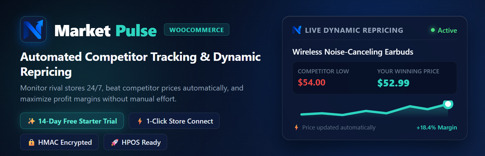
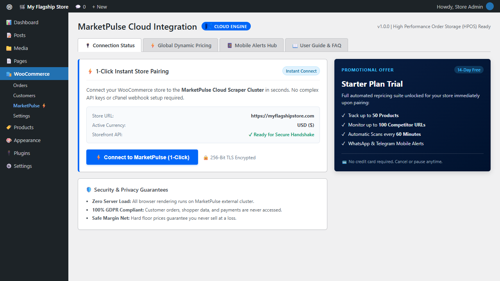
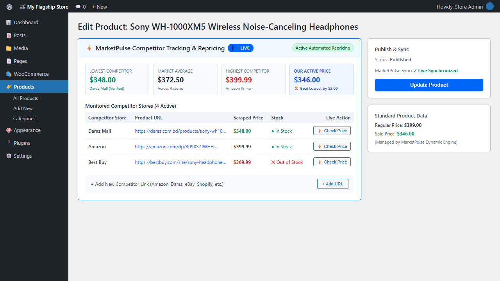
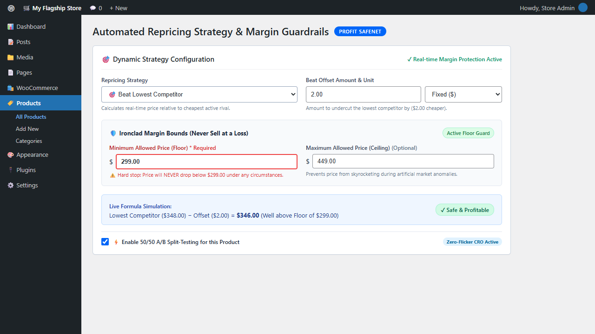
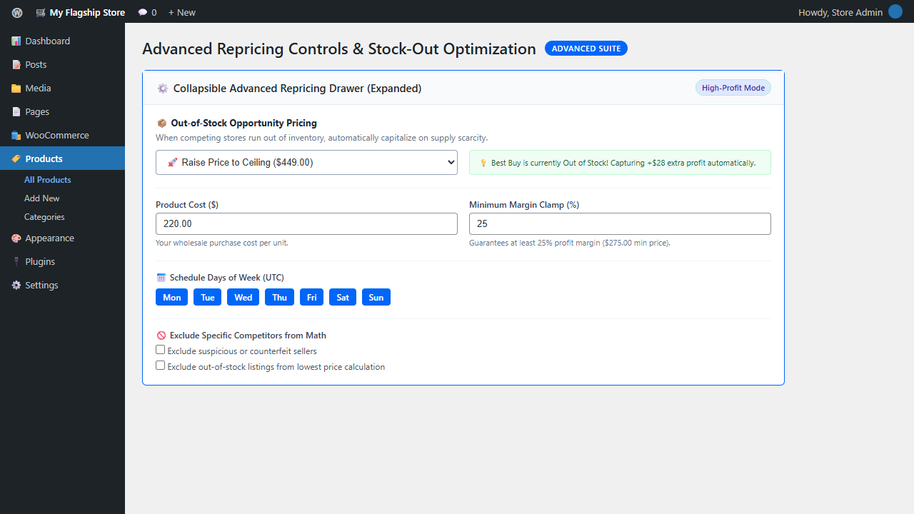
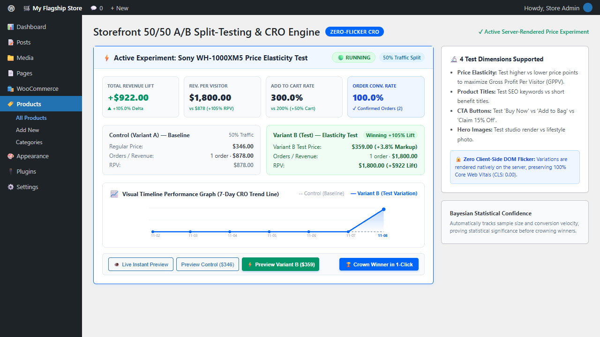
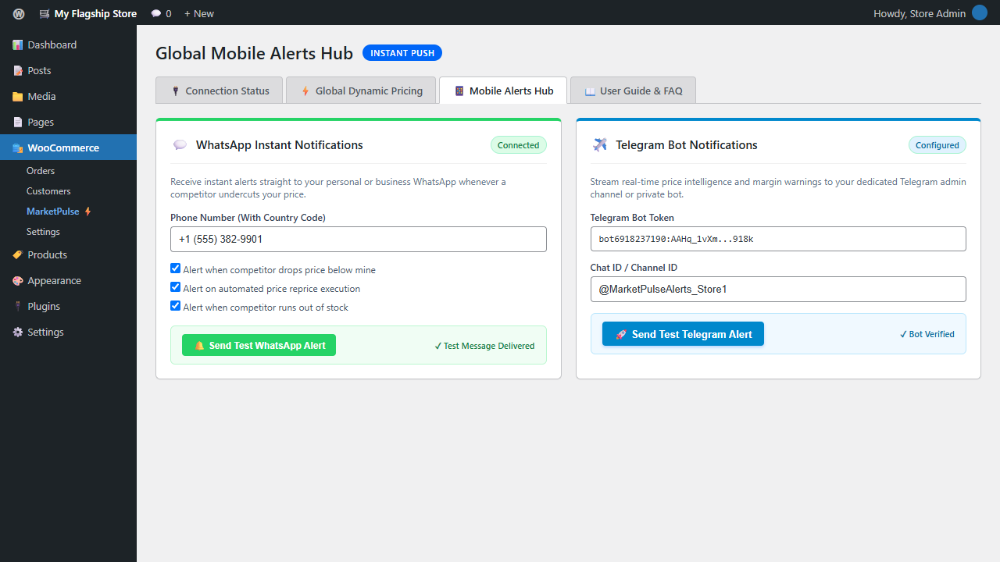
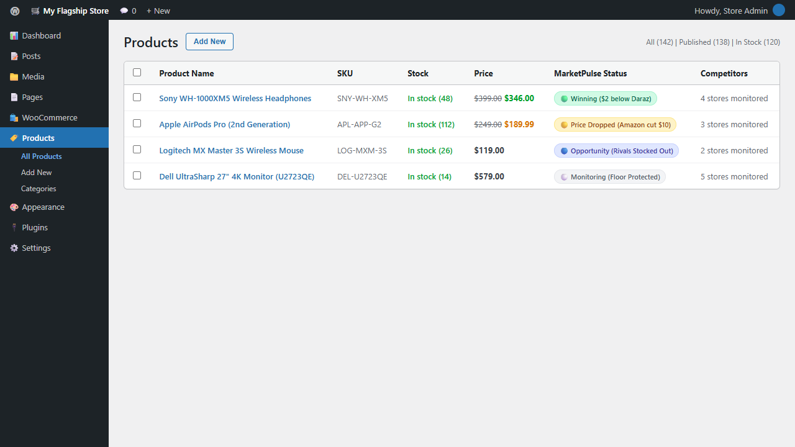
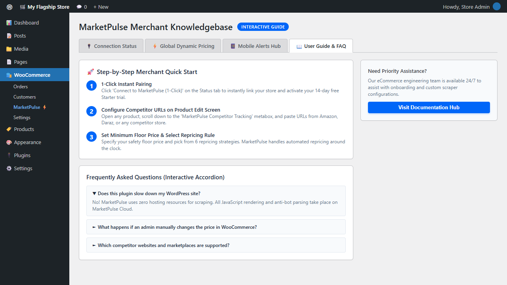

  

  <strong>Automated WooCommerce Dynamic Repricing, 24/7 Competitor Price Tracking &amp; Zero-Flicker 50/50 A/B Split-Testing Engine.</strong>

  
  
  
  
  
  

  <a href="https://usemarketpulse.com">Official Website</a> •
  <a href="https://usemarketpulse.com/login">Merchant Portal</a> •
  <a href="https://usemarketpulse.com/pricing">14-Day Free Trial</a> •
  <a href="#key-features">Key Features</a> •
  <a href="#installation">Installation</a>

---

## 🚀 Stop Losing Sales to Competitors. Win the Buy Box on Autopilot.

Are you manually browsing competitor websites every morning, copying prices into spreadsheets, and struggling to stay competitive? Or worse, losing high-intent shoppers to Amazon, Daraz, or rival stores because your price was just \$1 higher?

**[MarketPulse for WooCommerce](https://usemarketpulse.com)** is the next-generation, cloud-powered automated repricing and competitor price monitoring companion built specifically for modern WooCommerce merchants.

MarketPulse tracks competitor product prices 24/7 across **Amazon, Daraz, eBay, Walmart, AliExpress, Shopify stores, and custom eCommerce websites**, and automatically adjusts your WooCommerce prices in real-time based on your custom profit rules — **with ironclad margin floor protection so you never sell at a loss.**

---

## 💎 Why MarketPulse is 10x Ahead of Traditional Repricing Plugins

Most older WooCommerce repricing plugins run heavy scraping scripts on your local WordPress server, crashing shared hosting, getting your server IP banned by Cloudflare, or triggering devastating "race-to-the-bottom" price wars.

Here is how MarketPulse changes the game:

| Feature / Capability | Traditional WP Plugins | MarketPulse for WooCommerce |
| :--- | :--- | :--- |
| **Hosting Impact & Speed** | ❌ Heavy PHP cURL & Headless Chrome freezes your WordPress host | ✅ **Zero Host Server Bloat** (Scraped 100% on [MarketPulse Cloud](https://usemarketpulse.com)) |
| **Setup & Onboarding** | ❌ Complex API key copying & webhook debugging | ✅ **1-Click Instant Pairing** (Connected & live in under 3 seconds) |
| **Pricing Safeguards** | ⚠️ Basic or missing floor protection; risk of negative margins | ✅ **Triple-Layer Net:** Hard Floor + Optional Ceiling + Minimum Margin Clamp |
| **Repricing Strategies** | ⚠️ Only 1 or 2 simplistic "beat lowest" options | ✅ **6 Advanced Strategies** (Beat Lowest, Match, Average, Premium, Margin, Rank) |
| **Storefront A/B Testing** | ❌ No price elasticity or CRO split-testing | ✅ **Built-in 50/50 A/B Testing Engine** (Zero-flicker price, title & CTA testing with revenue lift metrics) |
| **Out-of-Stock Opportunity** | ❌ Ignored; leaves money on the table | ✅ **Smart Stock-Out Mode** (Raises price to ceiling when competitors run out of stock) |
| **Mobile Push Alerts** | ❌ Slow emails that get lost in spam folders | ✅ **Instant Real-Time WhatsApp & Telegram Alerts** directly to your phone |
| **Cache Compatibility** | ⚠️ Stale prices shown to buyers due to caching | ✅ **Instant Cache-Busting** for LiteSpeed, WP Rocket, W3TC & Cloudflare |
| **Product Variations** | ⚠️ Frequently breaks on variable products | ✅ **Full Support for Variations** (Per-variation SKU, URLs & floor rules) |
| **Conversion Rate (CRO)** | ❌ No storefront customer trust elements | ✅ **Built-in "Best Price Guarantee" Storefront Trust Badge** |

---

## ⚡ Key Features

### 1. 100% Cloud-Powered Scraping (Zero Server Bloat)
Unlike legacy plugins that execute resource-heavy web scrapers on your WordPress server, MarketPulse offloads all DOM parsing, JavaScript rendering (Playwright/Puppeteer), anti-bot mitigation, and algorithmic math to the high-performance **[MarketPulse Cloud Infrastructure](https://usemarketpulse.com)**. Your store stays lightning-fast and your hosting resources remain 100% dedicated to serving customers.

### 2. 6 Intelligent Repricing Strategies
Tailor your pricing logic per product with surgical precision:
* **Beat Lowest Competitor:** Price lower than your cheapest competitor by a fixed amount (e.g., \$1.00 or 5%).
* **Match Lowest Competitor:** Price-match the lowest competitor penny-for-penny to maximize conversion.
* **Target Market Average:** Balance profitability and competitiveness by pegging your price to the average competitor price.
* **Match Highest Competitor:** Premium brand positioning — position your product as a luxury alternative.
* **Fixed Margin Above Cost:** Maintain healthy bottom-line profits with automated cost-plus markup.
* **Position-Based Rank:** Target the 2nd lowest or 3rd lowest price to stay competitive without triggering price wars.

### 3. Storefront 50/50 A/B Split-Testing Engine (Zero-Flicker CRO)
Stop guessing which price point or headline converts best:
* **Zero-Flicker Server Rendering:** Price variations, titles, and CTA buttons are rendered natively on the server before the browser paints — no jarring layout shifts (CLS: 0.00) or client-side DOM replacement flickers.
* **50/50 Sticky Visitor Sessions:** Automatically allocates shoppers 50/50 between Control (Variant A) and Test (Variant B) using lightweight, GDPR-compliant cookie hashing.
* **Real-Time Financial Lift Analytics:** Measure the exact financial impact with **Revenue Per Visitor (RPV)**, **Total Revenue Lift ($)**, **Add-to-Cart Lift**, and **Purchase Conversion Rates**.
* **1-Click Winner Crowning:** Once statistical confidence is reached, permanently apply the winning variation to WooCommerce with a single click.

### 4. Ironclad Profit Floor & Ceiling Safeguards
Never sell at a loss again. Set a mandatory **Minimum Allowed Price (Floor)** and an optional **Maximum Allowed Price (Ceiling)**. No matter how low competitors slash their prices, MarketPulse will **NEVER** lower your price below your floor.

### 5. Out-of-Stock Opportunity Pricing
When your competitors run out of inventory, why keep your price low? MarketPulse detects competitor stock-outs and automatically increases your price to your configured ceiling or a custom markup percentage — capturing maximum profit when market supply is constrained.

### 6. Instant Mobile Alerts via WhatsApp & Telegram
Get real-time push notifications delivered straight to your smartphone the exact second a competitor changes their price or an automated repricing rule executes. Stay ahead of market shifts wherever you are.

### 7. Automated Cache-Busting
When MarketPulse updates a product price, it instantly purges the specific product page cache across **LiteSpeed Cache, WP Rocket, W3 Total Cache, WP Super Cache, Breeze, and Cloudflare**. Shoppers always see your accurate, competitive price immediately.

---

## 📸 Screenshots

| Feature | Preview |
| :--- | :--- |
| **1-Click Store Pairing** |  |
| **Live Market Intelligence** |  |
| **6 Repricing Strategies** |  |
| **Out-of-Stock Opportunity** |  |
| **50/50 A/B Split-Testing & CRO** |  |
| **WhatsApp & Telegram Alerts** |  |
| **Catalog Live Badges** |  |
| **In-Admin User Guide** |  |

---

## 🛠️ Installation

### Option 1: Automatic Installation (via WordPress Admin)
1. Log in to your WordPress admin dashboard.
2. Navigate to **Plugins > Add New**.
3. Search for **"MarketPulse"** or **"WooCommerce Repricing"**.
4. Click **Install Now**, then click **Activate**.
5. Go to **WooCommerce > MarketPulse** and click **"Connect to MarketPulse (1-Click)"**.
6. Your 14-day free Starter trial is activated instantly!

### Option 2: Manual Installation (GitHub Release / ZIP)
1. Download the latest `marketpulse-for-woocommerce.zip` release from this repository.
2. In your WordPress admin, go to **Plugins > Add New > Upload Plugin**.
3. Choose the ZIP file and click **Install Now**.
4. Activate the plugin and follow the 1-Click pairing flow.

---

## 🔒 Security & Privacy Guarantee

MarketPulse is engineered with strict privacy standards:
* **GDPR Compliant:** MarketPulse NEVER accesses, transmits, or stores customer personal data, shopper information, customer orders, or payment details.
* **Safe External Architecture:** Product synchronization only handles public product catalog attributes (SKU, title, price, competitor links).
* **High-Performance Order Storage (HPOS):** Fully compatible and certified with WooCommerce HPOS mode.

---

## 🎁 14-Day Free Starter Trial

Every new WooCommerce store paired with MarketPulse automatically receives a **14-day free trial on the Starter Plan**:
* Track up to **50 Products**
* Monitor up to **100 Competitor URLs**
* **60-Minute Automatic Price Scans**
* Full access to all 6 repricing strategies and mobile alerts
* **No credit card required** to get started

👉 **[Start your 14-day free trial on usemarketpulse.com](https://usemarketpulse.com)**

---

## 📄 License

This plugin is free and open-source software, licensed under the **GNU General Public License v2 or later (GPL-2.0+)**.
